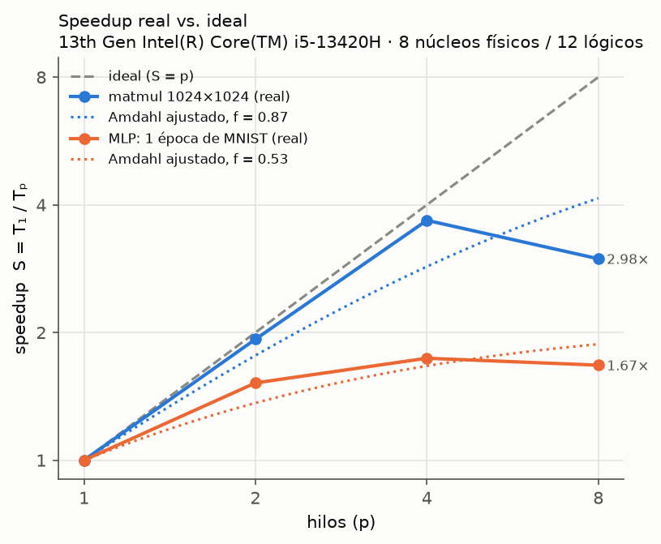
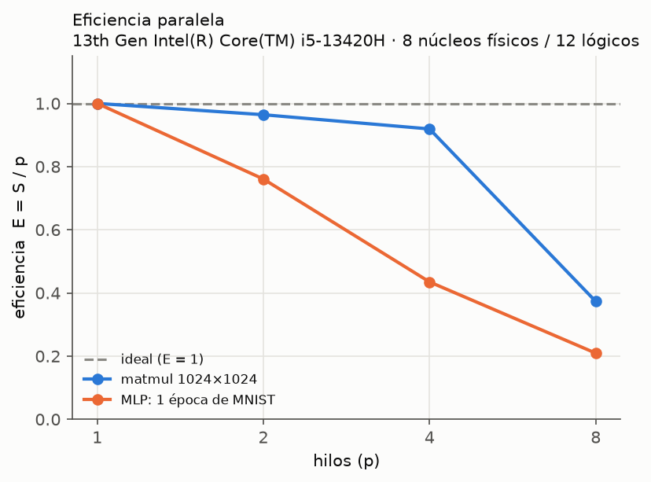
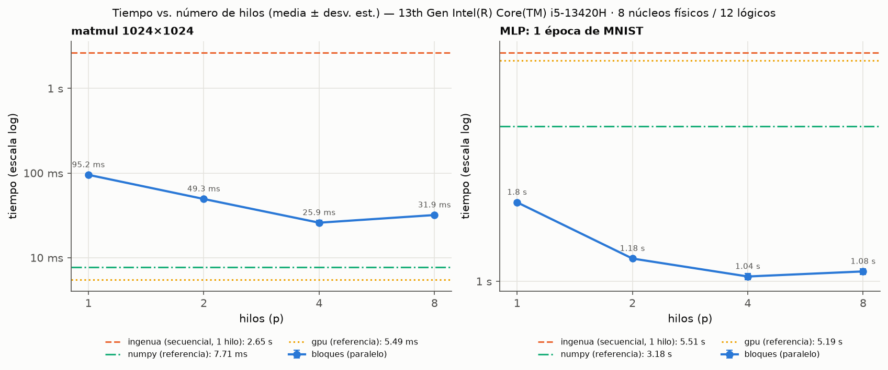
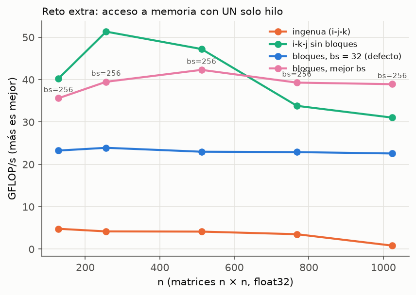

# MLP paralelo para MNIST: multiplicación de matrices secuencial, por bloques y en GPU

Proyecto de **Cómputo Paralelo**. Implementamos desde cero una red neuronal
multicapa (MLP) que clasifica dígitos escritos a mano (MNIST) y, como opción,
prendas de ropa (Fashion-MNIST). Además programamos **nosotros mismos** la
multiplicación de matrices, que es la operación más costosa de la red, en
cuatro versiones intercambiables, y medimos cuánto se acelera al paralelizarla.

**Equipo:** David Atilano · Ricardo Ordaz · Daniela Sánchez · Javier Narváez

> No se usa PyTorch, TensorFlow ni sklearn para la red. sklearn se usa
> **solo** para descargar los datos (`fetch_openml`).

---

> 📘 **Para entender el proyecto paso a paso:** [docs/BITACORA.md](docs/BITACORA.md)
> cuenta qué se hizo en cada etapa, con enlaces al código.
> [docs/PRUEBAS.md](docs/PRUEBAS.md) explica cada uno de los 130 tests y los
> experimentos de rendimiento.

## Contenido

1. [Resultados en breve](#resultados-en-breve)
2. [Estructura del repositorio](#estructura-del-repositorio)
3. [Instalación](#instalación)
4. [Cómo ejecutar todo](#cómo-ejecutar-todo)
5. [Docker](#docker)
6. [GPU en Google Colab](#gpu-en-google-colab)
7. [Diseño](#diseño)
8. [Metodología de medición](#metodología-de-medición)
9. [Resultados y discusión](#resultados-y-discusión)
10. [Uso de asistentes de IA](#uso-de-asistentes-de-ia)

---

## Resultados en breve

Equipo de pruebas: Intel Core i5-13420H (8 núcleos físicos: 4 de rendimiento
y 4 de eficiencia, 12 hilos lógicos), 16 GB de RAM y NVIDIA RTX 4050 Laptop
(6 GB), con Windows 11. Las especificaciones completas están en
[`results/especificaciones.json`](results/especificaciones.json).

**Precisión del MLP** (784 → 128 → 64 → 10, 10 épocas, lote 64, tasa 0.1, semilla 0):

| Conjunto | ingenua | bloques | gpu | numpy |
|---|---|---|---|---|
| MNIST | 97.91 % | 97.91 % | 97.99 % | 97.91 % |
| Fashion-MNIST | — | — | — | 86.85 % |

El backend no cambia lo que aprende la red: las diferencias son solo de
redondeo en punto flotante.

**Escalabilidad** (versión por bloques, media de 5 repeticiones):

| Hilos | matmul 1024×1024 | S | E | MLP, 1 época | S | E |
|---|---|---|---|---|---|---|
| 1 | 95.2 ms | 1.00 | 1.00 | 1.80 s | 1.00 | 1.00 |
| 2 | 49.3 ms | 1.93 | 0.96 | 1.18 s | 1.52 | 0.76 |
| 4 | 25.9 ms | 3.68 | 0.92 | 1.04 s | 1.74 | 0.43 |
| 8 | 31.9 ms | 2.98 | 0.37 | 1.08 s | 1.67 | 0.21 |
| **Fracción paralela f (Amdahl)** | | **0.87** | | | **0.53** | |

Contra la versión ingenua secuencial, la matmul por bloques con 4 hilos es
**102 veces** más rápida (2.65 s → 25.9 ms) y el entrenamiento **5.3 veces**
más rápido (5.51 s → 1.04 s por época).

| | |
|---|---|
|  |  |
|  |  |

Todas las tablas están en [`results/resumen.md`](results/resumen.md).

---

## Estructura del repositorio

```
src/
  matmul.py          las 4 versiones de matmul (+ registro BACKENDS)
  matmul_gpu.py      kernel CUDA con numba.cuda
  validacion.py      validación de entradas común a todas las versiones
  mlp.py             MLP: forward, backpropagation, SGD por mini-lotes
  datos.py           descarga y carga de MNIST / Fashion-MNIST
tests/
  test_matmul.py     cada backend contra NumPy (np.allclose)
  test_bloques.py    distintos tamaños de bloque y número de hilos
  test_gpu.py        detalles de CUDA (se saltan si no hay GPU)
  test_mlp.py        verificación de gradientes y equivalencia entre backends
  test_metricas.py   fórmulas de speedup y Ley de Amdahl
experiments/
  entrenar.py        entrena el MLP con el backend elegido
  especificaciones.py  registra CPU, núcleos, RAM y GPU del equipo
  bench_hilos.py     escalabilidad con 1, 2, 4, 8 hilos
  bench_cache.py     reto extra: ingenua vs. bloques con 1 hilo
  bench_gpu.py       GPU: cómputo vs. copias CPU↔GPU
  graficas.py        gráficas PNG y resumen.md
  correr_todo.py     corre todo lo anterior en orden
  medicion.py        cronómetro, speedup, Amdahl (código compartido)
results/             CSV, JSON y PNG generados por los experimentos
notebooks/
  mlp_gpu_colab.ipynb  versión para Google Colab con GPU
requirements.txt     dependencias (CPU) con versiones fijas
requirements-gpu.txt dependencias extra para GPU NVIDIA
Dockerfile           imagen reproducible (CPU)
```

---

## Instalación

Requisitos: **Python 3.13**, que es la versión con la que se probó todo
(laptop y Docker).

```bash
# 1. Crear y activar un entorno virtual
python -m venv .venv
.venv\Scripts\activate          # Windows (PowerShell)
source .venv/bin/activate       # Linux / macOS

# 2. Instalar dependencias
pip install -r requirements.txt

# 3. (Opcional) Soporte para GPU NVIDIA
pip install -r requirements-gpu.txt
```

Sobre la GPU:
- `numba-cuda` trae el compilador y el runtime de CUDA como paquetes de pip,
  así que **no hace falta instalar el CUDA Toolkit**, solo tener un
  controlador NVIDIA reciente.
- `requirements-gpu.txt` usa `cu13`, para controladores con CUDA 13. Si
  `nvidia-smi` muestra CUDA 12.x, cambia `cu13` por `cu12` en ese archivo.
- NumPy está fijo en 2.4.6 porque `numba-cuda` 0.30 todavía usa una función
  que se eliminó en NumPy 2.5.

---

## Cómo ejecutar todo

Todos los comandos se ejecutan **desde la raíz del repositorio**.

```bash
# Tests de correctitud (unos 10 s)
python -m pytest -q

# Entrenar el MLP (la primera vez descarga MNIST, ~50 MB)
python -m experiments.entrenar                          # backend numpy
python -m experiments.entrenar --backend ingenua
python -m experiments.entrenar --backend bloques --hilos 4 --bloque 32
python -m experiments.entrenar --backend gpu
python -m experiments.entrenar --dataset fashion --epocas 15

# Todos los experimentos + gráficas (~3-5 min en nuestra laptop)
python -m experiments.correr_todo --reps 5
python -m experiments.correr_todo --rapido              # prueba corta (~10 s)

# O cada experimento por separado
python -m experiments.especificaciones
python -m experiments.bench_hilos --reps 5 --hilos 1 2 4 8
python -m experiments.bench_cache --reps 3
python -m experiments.bench_gpu
python -m experiments.graficas
```

Cada script acepta `--help` para ver sus opciones.

**Demostración en vivo para la presentación** (4 partes, se detiene con Enter):

```bash
python -m experiments.demo_en_vivo              # completa (~3 min de ejecución)
python -m experiments.demo_en_vivo --parte 2    # ensayar una sola parte
```

**Para medir bien en una laptop:** conéctala a la corriente, usa el modo de
máximo rendimiento y cierra otros programas pesados. Con batería, el
procesador baja su frecuencia y los tiempos varían mucho.

---

## Docker

La imagen corre todo **en CPU**. Para la GPU usa Colab (siguiente sección):
dar acceso a la GPU a un contenedor requiere el NVIDIA Container Toolkit, y
en Windows además WSL2 con CUDA.

```bash
# Construir la imagen
docker build -t mlp-paralelo .

# Tests (es el comando por defecto)
docker run --rm mlp-paralelo
```

Para conservar los datos descargados y los resultados fuera del contenedor,
monta `data/` y `results/` como volúmenes:

```powershell
# Windows PowerShell
docker run --rm -v ${PWD}/data:/app/data -v ${PWD}/results:/app/results mlp-paralelo python -m experiments.correr_todo --reps 5
```
```bash
# Linux / macOS
docker run --rm -v "$PWD/data:/app/data" -v "$PWD/results:/app/results" mlp-paralelo python -m experiments.correr_todo --reps 5
```

Nota: Docker Desktop corre los contenedores dentro de una máquina virtual,
así que los tiempos pueden diferir un poco de los medidos directamente en
Windows. Los resultados de este README se midieron fuera de Docker.

---

## GPU en Google Colab

1. Abre [`notebooks/mlp_gpu_colab.ipynb`](notebooks/mlp_gpu_colab.ipynb) en
   Colab (*Archivo → Subir notebook*).
2. Activa la GPU en *Entorno de ejecución → Cambiar tipo de entorno de
   ejecución → GPU (T4)*.
3. Obtén el código: escribe la URL del repositorio en `REPO_URL` o, si lo
   dejas vacío, sube un `.zip` del proyecto sin la carpeta `.venv`.
4. Ejecuta todas las celdas. El notebook instala `numba-cuda`, corre los
   tests, mide la GPU (cómputo contra copias) y entrena el MLP.

---

## Diseño

### Cuatro versiones de matmul con la misma firma

Las cuatro tienen la firma `matmul(A, B) -> C` y están registradas en
`BACKENDS` (`src/matmul.py`). El MLP recibe la función como parámetro:
`MLP(matmul=...)`. Los tests recorren `BACKENDS`, así que una versión nueva
queda probada automáticamente.

| Versión | Idea | Detalles |
|---|---|---|
| **ingenua** | Triple ciclo `i-j-k` con `@njit`. Es la **línea base** de todas las mediciones | Lee B por columnas, lo que provoca muchos fallos de caché |
| **bloques** | Mosaicos `bs×bs` (por defecto 32), orden `i-k-j` y `prange` | Cada hilo calcula mosaicos completos de C, así que no hay condiciones de carrera. Las rebanadas 1D de cada fila permiten instrucciones SIMD (~7 veces más rápido que con índices 2D) |
| **gpu** | Kernel CUDA con mosaicos de 16×16 en memoria compartida | Usa `syncthreads` y acceso coalescente. Solo se registra si hay GPU |
| **numpy** | `A @ B` (BLAS) | Referencia "de producción" y "respuesta correcta" de los tests |

Para el reto extra existe una quinta variante de apoyo, `matmul_ikj` (orden
`i-k-j` sin bloques). Sirve para separar el efecto del orden de acceso del
efecto de los bloques.

### La red

- **Arquitectura:** 784 → 128 → 64 → 10, con ReLU en las capas ocultas y
  softmax con entropía cruzada en la salida.
- **Inicialización:** He, `N(0, √(2/n))`. **Optimización:** SGD por
  mini-lotes, barajando los datos en cada época.
- **Backpropagation:** se usan 3 matmul por capa en cada paso:
  - `Z = A·W` en el forward;
  - `dW = Aᵀ·dZ` y `dA = dZ·Wᵀ` en el backward.
- **Verificación:** el gradiente se compara contra diferencias finitas
  (`tests/test_mlp.py`).
- **Reproducibilidad:** con la misma semilla, la red parte de los mismos
  pesos y ve los lotes en el mismo orden con cualquier backend.

---

## Metodología de medición

- **Calentamiento:** antes de medir se hace una llamada que no se cuenta,
  para excluir la compilación JIT de Numba. En la GPU además hay 1.5 s de
  trabajo sostenido para que suba su reloj (ver la discusión).
- **Cronómetro:** `time.perf_counter`.
- **Repeticiones:** 5 por configuración (el mínimo pedido era 3). Se
  reportan la **media** y la **desviación estándar muestral**.
- **Hilos:** 1, 2, 4 y 8, fijados con `numba.set_num_threads(p)`.
- **Métricas:**
  - speedup `S = T₁ / Tₚ` (respecto a la misma versión con 1 hilo);
  - eficiencia `E = S / p`;
  - fracción paralela con la Ley de Amdahl, `S = 1 / ((1 − f) + f/p)`. Se
    reporta despejada para cada p y ajustada por mínimos cuadrados con todos
    los p.
- **Dos cargas:**
  - una matmul de 1024×1024, que es casi 100 % paralela;
  - una época completa del MLP en MNIST, que incluye partes seriales: ReLU,
    softmax, actualización de pesos y el ciclo de Python.

---

## Resultados y discusión

**1. La matmul escala casi idealmente hasta 4 hilos** (E = 0.92). Cada hilo
calcula mosaicos independientes de C, sin sincronización entre ellos.

**2. Con 8 hilos el tiempo empeora.** Hay tres causas:
- El i5-13420H es **híbrido**: con 8 hilos ya se usan los 4 núcleos de
  eficiencia, que son más lentos.
- `prange` reparte las iteraciones en partes iguales, así que los núcleos
  rápidos terminan antes y esperan a los lentos.
- Coordinar más hilos tiene un costo mayor.

La Ley de Amdahl supone núcleos idénticos, y por eso el punto de 8 hilos se
sale del modelo y baja la f ajustada.

**3. El MLP escala mucho peor (f ≈ 0.53).** Solo paralelizamos el matmul. El
resto (ReLU, softmax, actualización de pesos, barajado y el ciclo de Python)
es serial. Además, con lotes de 64 las matrices son pequeñas: un C de 64×10
tiene solo 2 mosaicos. Amdahl predice un límite de
`1/(1−f) ≈ 2.1` veces de speedup **aunque hubiera infinitos hilos**.

**4. Reto extra: caché con un solo hilo** (GFLOP/s, más es mejor):

| n | ingenua | i-k-j sin bloques | bloques (mejor bs) |
|---|---|---|---|
| 256 | 4.18 | 51.33 | 39.50 |
| 512 | 4.13 | 47.23 | 42.31 |
| 768 | 3.52 | 33.82 | 39.30 |
| 1024 | **0.83** | 31.04 | **38.93** |

- **De ingenua a i-k-j (unas 10 veces más rápido):** es el efecto del orden
  de acceso. Leer B por filas aprovecha cada línea de caché de 64 bytes
  completa y permite SIMD.
- **De i-k-j a bloques:** con n pequeño, i-k-j **gana**, porque todo cabe en
  caché y los bloques solo agregan trabajo. Desde n = 768, B ya no cabe en
  la caché: i-k-j cae y bloques se mantiene, porque reutiliza cada bloque
  mientras está en caché.
- **La ingenua con n = 1024 se desploma:** con un salto de 1024 elementos,
  las columnas de B caen en los mismos conjuntos de la caché y se expulsan
  entre sí (conflictos de asociatividad).
- **Tamaño de bloque:** con un hilo, bloques más grandes rinden más porque el
  ciclo vectorizado es más largo
  ([`cache_tam_bloque.png`](results/cache_tam_bloque.png)). En el MLP usamos
  32 porque genera más mosaicos para repartir entre hilos. Es un compromiso
  entre localidad y paralelismo.

**5. La GPU solo conviene si hay suficiente cálculo**
([`gpu.png`](results/gpu.png)):
- El kernel llega a unos 900 GFLOP/s, pero cada llamada copia A, B y C por
  PCIe.
- Con n = 64, las copias son el 90 % del tiempo.
- Por eso, entrenar el MLP con `gpu` tarda 5.2 s por época, más lento que
  `bloques` en CPU.
- La mejora sería mantener pesos y activaciones en la GPU durante todo el
  entrenamiento, lo que obliga a mover también ReLU, softmax y SGD a la GPU.

**6. Sobre las mediciones:**
- En una laptop, la CPU y la GPU comparten el límite de energía. En la
  primera corrida, la GPU midió hasta 5 veces más lento justo después de
  minutos de CPU al 100 %. Por eso agregamos el calentamiento sostenido.
- La referencia de NumPy en el MLP varía mucho (± 2.3 s), porque NumPy usa
  sus propios hilos (OpenBLAS), que `set_num_threads` no controla. No afecta
  las métricas de Amdahl, que solo usan la versión por bloques.

---

## Uso de asistentes de IA

Declaramos que en este proyecto usamos **Claude Code**, un asistente de
programación de Anthropic (modelo Claude Opus 5.5), de la siguiente manera:

**Qué definimos nosotros**
- El planteamiento completo: requisitos, arquitectura de la red, las cuatro
  versiones de matmul, métricas, experimentos y estructura del repositorio.
- El plan de trabajo en 6 etapas, con revisión del equipo al terminar cada
  una antes de autorizar la siguiente.

**Qué hizo el asistente**
- Escribió el código de `src/`, `tests/` y `experiments/`, el notebook de
  Colab, el `Dockerfile` y este README, con comentarios en español que
  explican el porqué de cada paso.
- Ejecutó los tests y los experimentos en nuestra laptop y generó los
  resultados y las gráficas de `results/`.
- Al final de cada etapa entregó un resumen de lo hecho y de los conceptos
  que debíamos entender.
- Detectó y documentó problemas durante el desarrollo:
  - la incompatibilidad entre sklearn y pandas 3 al descargar los datos;
  - la falta de vectorización con índices 2D en el kernel por bloques;
  - la incompatibilidad entre `numba-cuda` y NumPy 2.5;
  - el reloj bajo de la GPU de la laptop después de carga de CPU.

**Cómo verificamos el trabajo**
- 130 tests automáticos: cada backend contra NumPy, verificación numérica
  del gradiente, equivalencia del entrenamiento entre backends y las
  fórmulas de Amdahl.
- Revisión de cada etapa por el equipo.
- El notebook de Colab **no** lo ejecutó el asistente en Colab. Lo probamos
  nosotros en Colab con GPU T4: _[completar: fecha y resultado]_.

**Revisión del equipo** _(completar)_
- Qué partes modificamos o reescribimos nosotros: _[completar]_
- Qué explicaciones verificamos con otras fuentes (apuntes, documentación de
  Numba y CUDA): _[completar]_

Todos los integrantes revisamos el código y somos responsables de poder
explicar cualquier parte del proyecto.
